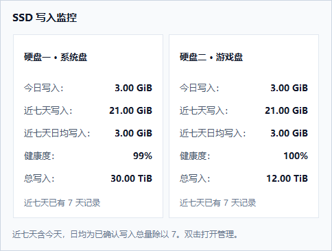

# SSD Write Monitor 2.1.1

Windows 多固态硬盘写入监控，常驻系统托盘。优先支持 NVMe SSD，包括后续加装的多块固态盘。

## 直接使用

从 [GitHub Releases](https://github.com/SunZe1/ssd-write-monitor/releases/latest) 下载
**SSDMonitor-2.1.1-portable.zip**，解压到可写文件夹。
退出旧版托盘程序，再双击 **SSDMonitor.exe**。
本地构建后也可直接运行项目根目录的 exe，便携包位于 dist 目录。

便携版内置 Python 运行时、界面组件及 smartctl，无需另装 Python / smartmontools。
配置和日志位于 exe 旁的 data 文件夹。双击托盘图标打开硬盘管理；关闭管理窗口只隐藏窗口。

完整操作说明见 [使用说明.txt](使用说明.txt)。

## 功能

- 自动发现多块物理 SSD；同一硬盘的 C:、D: 等分区合并显示。
- 按型号与序列号识别硬盘，缺少序列号时使用 WWN；身份不明确或重复时暂缓统计。
- 每盘独立记录今日已确认写入、累计主机写入、温度、NVMe 健康度估计与历史趋势。
- 支持别名、启用/停用、立即采集、重新扫描、5/10/30/60 分钟间隔、暂停与开机自启。
- 托盘悬停浮窗按硬盘分列，每列竖向显示今日写入、近七天写入、近七天日均写入、健康度、总写入。
- 单盘读取失败不阻断其他硬盘；离线硬盘保留历史，重接后重新关联。
- 整机进程 I/O 单独记录，明确不归属到具体硬盘；过滤 PID 重用导致的错误差值。
- 后台错误写入轮转日志，界面显示读取、配置及 Excel 保存异常。

## 托盘悬停显示

图标收在隐藏区域时，先点击托盘上箭头展开面板。将鼠标停在 SSD 图标上约 0.3 秒即可查看浮窗。

```text
硬盘一                      硬盘二
今日写入：3.00 GiB          今日写入：3.00 GiB
近七天写入：21.00 GiB       近七天写入：21.00 GiB
近七天日均写入：3.00 GiB    近七天日均写入：3.00 GiB
健康度：99%                 健康度：100%
总写入：30.00 TiB           总写入：12.00 TiB
```



上图使用示例数据。每块物理硬盘独立一列；同一硬盘的 C:、D: 分区仍归为一块盘。
浮窗采用固定网格对齐，硬盘较多时自动换行并支持滚动。移开鼠标后自动隐藏，
悬停不会抢走其他程序的输入焦点；双击图标或浮窗可打开硬盘管理。

“近七天写入”是含今天在内最近 7 个自然日的已确认写入总量，合并已保存记录、
待写队列和当前状态，并按日期、硬盘去重。每列注明已有记录的天数，缺失日期不估算。
浮窗的“近七天日均写入”按上述总量除以 7 计算，即使只有部分日期有记录也按 7 天计算。
“总写入”是 SMART 累计主机写入量。离线、读取失败或历史不可用时会显示状态或“—”。

## 统计口径

NVMe 从 smartctl JSON 中读取 Data Units Written，每单位为 512,000 字节。
健康度估计为 max(0, 100 - Percentage Used)，关键告警单独显示，缺少字段时显示“—”。
健康百分比来自设备厂商的寿命估算，不能保证设备没有其他故障。

首次采样建立基线；同一自然日内的后续差值计入当天。
跨午夜、跨多日的区间写入保留在“未分配”字段，不强行分配到恢复当天。
因此今日已确认量不一定覆盖完整一天；区间明细保留总增量与起止时间。

暂停/停用期间不写采样记录，恢复后从上次基线计算增量，跨日继续使用未分配口径。
累计计数回退时重新建立基线并记录异常。系统时钟回退时暂缓该盘统计。
历史趋势中的“近 7 日采样日均”只使用最近 7 个自然日中有记录的日期，缺失日期不当作零。

GiB / TiB 使用 1024 进制；设备容量 GB 使用 1000 进制。
SATA 只接受明确标注写入单位的属性，不再把所有 F1 / 241 都当成 32MiB。

## 数据保存与升级

每轮采样的状态、明细、每日汇总和待写队列通过一次配置原子替换持久化。
之后批量导出 xlsx；Excel 占用或导出中断时保留队列，每 30 秒重试。
恢复后按记录 ID、日期与硬盘 ID 去重，避免重复追加或累计。
读不到工作簿时保留原文件，不自动清空历史；真实损坏需恢复备份或修复工作簿。

旧版升级前备份配置和原三份 xlsx 到 data/backups。
由于旧版没有记录可靠设备身份，旧历史和状态保留在 legacy 信息及备份中，
不依据设备路径猜测绑定；新版为各盘建立独立基线。

本地旧版源码、旧 exe 和旧便携包集中保存在 `old_versions/`，该目录已加入 `.gitignore`，
不提交到 GitHub，也不进入新版便携包。当前配置与监控日志仍保存在 `data/`。

| 文件 | 用途 |
|---|---|
| data/config.json | 配置、每盘状态、待写队列 |
| data/monitor.log | 运行日志，2 MB 轮转，保留 3 份 |
| data/v2/write_log-YYYY-MM.xlsx | 每盘采样明细，按月保存 |
| data/v2/daily_summary.xlsx | 日期＋硬盘的每日汇总 |
| data/v2/trend_summary.xlsx | 每盘趋势、近 7 日采样日均 |
| data/v2/process_activity-YYYY-MM.xlsx | 整机进程 I/O 参考 |

## 开发与验证

使用项目原有 conda query 环境：

    conda run -n query python -m pip install -r requirements.txt
    conda run -n query python disk_monitor.py
    conda run -n query python -m unittest discover -s tests -v

测试使用临时目录和模拟硬盘，覆盖新增硬盘、换槽、替换、掉线、禁用、重复身份、
跨日/多日、计数回退、配置写入失败、Excel 占用重试、重启去重、健康度、
七日总量与待写数据去重、悬停分列布局与隐藏行为，以及 Windows 界面与升级互斥。

打包：

    conda run -n query python -m pip install -r requirements-build.txt
    ./build.ps1

build.ps1 默认使用用户目录中的 conda query，也可通过 -PythonPath 指定解释器。
构建会先运行测试，再生成根目录 SSDMonitor.exe 及 dist 下的便携压缩包。
ssd_monitor.spec 同时支持常规 Python 和 conda 的 DLL 布局。
构建所需 smartctl 从 SMARTCTL_PATH、PATH 或默认安装目录寻找。

exe 诊断模式（只用临时数据目录，报告写到指定路径）：

    ./SSDMonitor.exe --self-test build/exe-selftest.json

## 模块

项目目录与本地旧版归档位置见 [目录说明](docs/project-layout.md)。
日常启动使用根目录 `SSDMonitor.exe`；旧 `启动.vbs` 已归档到 `old_versions/v1/scripts/`。

| 模块 | 职责 |
|---|---|
| disk_monitor.py | Tk 管理窗口、托盘、调度、单实例 |
| monitor_service.py | 每盘状态、统计、队列提交、故障隔离 |
| smart_reader.py | smartctl JSON、身份、健康度、盘符映射 |
| config_manager.py | 原子配置写入、旧版备份迁移 |
| csv_logger.py | xlsx 批量导出、去重和趋势 |
| tray_popup.py | 每盘一列的悬停浮窗、定位与显隐 |
| weekly_stats.py | 近七个自然日写入总量、合并与去重 |
| process_io_tracker.py | 整机进程 I/O 参考 |
| diagnostics.py | 源码/打包版本的隔离自检 |

smartmontools 的许可证和 7.5 源码归档随便携包附带，见 third_party/smartmontools。
